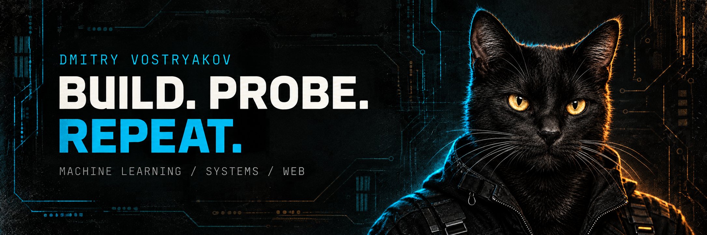

  

### Hey, I'm Dmitry.

I build across machine learning, systems, and the web. I like understanding what happens beneath the interface — and turning experiments into things you can inspect, run, and improve.

**Разбираюсь, как устроено. Собираю. Проверяю. Повторяю.**

---

### On the workbench

| Project | What I'm building |
| :--- | :--- |
| **[MLX-Spark](https://github.com/dmitryvostryakov/mlx-spark)** | An independent, NVIDIA-native ML framework for DGX Spark. Currently a pre-alpha engineering scaffold; target-hardware validation is ahead. |
| **[LazarevBJJ](https://github.com/dmitryvostryakov/LazarevBJJ)** | A GTA V-inspired landing page for BJJ trainer Nikita Lazarev, built with React and Vite. |

### How I build

`inspect the system` → `make it work` → `measure it` → `make it better`

Readable internals. Reproducible experiments. Clear limits. A little punk in the interface.

---

  <a href="https://github.com/dmitryvostryakov?tab=repositories">Explore the repositories ↗</a>

